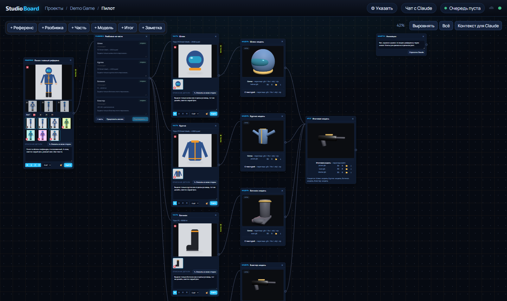
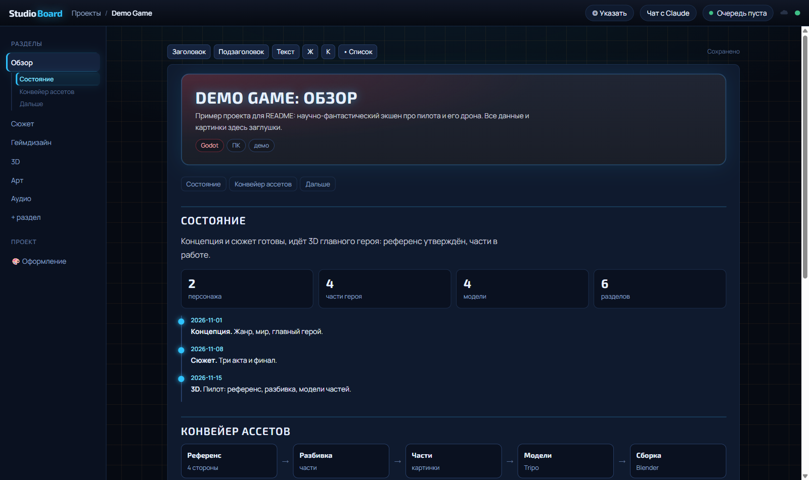

# Studio Board

Локальная доска для игровых проектов. Внутри проекта есть разделы: сюжет, 3D, звук и другие. Каждый персонаж или модель живёт на своей доске с карточками и связями между ними: главный референс → разбивка на части → референсы частей → модели → итоговая модель. Генерацию картинок по кнопке на карточке выполняет фоновый Claude Code во Flow.






На скриншотах демо-проект с картинками и моделями-заглушками.

## Запуск

```
node supervisor.mjs      # сервер с автоперезапуском, http://127.0.0.1:4777
```

На Windows запуск по ярлыку на рабочем столе: он вызывает `wscript start-hidden.vbs` с иконкой `public/icon.ico`. Скрипт поднимает сервер без окна, если тот ещё не запущен, и открывает доску в браузере. Журнал пишется в `data/server.log`. Очередь работает, только пока сервер запущен: автозапуска нет.

Нужны Node 20+ и Claude Code (`claude`), вошедший в аккаунт. В Chrome должно стоять расширение Claude in Chrome, а сам Chrome должен быть открыт и залогинен во Flow.

## Открыть модель в Blender

Кнопка «B» у модели открывает её исходный `.blend`, а не импортирует FBX/GLB в новый файл. Исходник ищется так:
1. В поле `blend` карточки (путь внутри `Projects`), если оно задано.
2. `.blend` с тем же именем рядом с любым файлом карточки (`models/head.fbx` → `models/head.blend`).
3. Такое же имя в папке игры, в том числе без суффикса версии и в единственном или множественном числе (`jacket-v3` → `jacket`, `glove` → `gloves`). Ближайший по папкам, при равенстве самый свежий. Папки `studio`, `_*` и `.*` пропускаются.

Если этот `.blend` уже открыт в Blender, второй раз он не открывается. Если исходника нет, модель добавляется в уже открытый Blender (новая коллекция `Studio: <имя файла>`, через сокет аддона Blender MCP, порт 9876 или `blenderPort` в `data/settings.json`), а без него открывается в новом Blender.

## Где лежат данные

- `data/`: список проектов, настройки (`settings.json`: `flowUrl`, `imageModel`, `worker`), очередь задач (`data/jobs/*.json` и журналы `*.log`). Папка не в git.
- `Projects/<папка игры>/studio/`: `project.json` (разделы, доски), `boards/<id>.json` (карточки, связи, контекст для Claude), `notes/<раздел>.html`, `assets/<доска>/<карточка>/` (картинки и модели).

Сервер ищет проекты в папке, которая лежит на уровень выше приложения: `Projects/studio-board` → `Projects`.

## Как работает очередь

1. Кнопка «Сгенерировать» создаёт задачу `data/jobs/<id>.json`.
2. Сервер по одной запускает `claude -p --chrome --permission-mode auto` и передаёт ему `worker-prompt.md` с данными задачи.
3. Claude генерирует во Flow и отправляет картинки прямо со страницы на `POST /api/jobs/<id>/image`. По ходу работы он пишет в журнал (`/log`), в конце вызывает `/complete`.
4. Доска опрашивает сервер раз в 2 секунды и показывает новые варианты.

Если сервер перезапустился, задача в статусе `running` один раз возвращается в очередь. Задача висит не дольше 45 минут.

Виды задач: `images` (картинки, 1–8 штук, 1 вид или лист с 4 сторонами), `split` (Claude предлагает разбивку на части), `note` (вопрос по файлам проекта).

## API (кратко)

`GET/POST /api/projects`, `GET/PATCH /api/projects/:pid`, `GET/PUT /api/projects/:pid/notes/:sid`,
`POST /api/projects/:pid/boards`, `GET/PATCH /api/projects/:pid/boards/:bid`,
`POST|PATCH|DELETE .../cards[/:cid]`, `POST|DELETE .../links[/:lid]`,
`POST .../cards/:cid/files?slot=&name=` (сырые байты; zip распаковывается),
`POST .../cards/:cid/generate`, `GET /api/jobs`, `POST /api/jobs/:id/{cancel,retry,log,image,complete}`,
`GET /files/<путь внутри Projects>`.

## Claude в проекте: «Указать», метки и чат

- **◎ Указать** (верхняя панель): кликни по блоку страницы, по карточке или пустому месту доски, или обведи область на доске рамкой. Напиши, что сделать. Появится метка с номером: в ней переписка с Claude и поле для уточнений. Задача уходит в очередь как `kind: "request"`, место описано в `where`. Исполнитель меняет страницу, доску, файлы проекта или модели в Blender (`worker-prompt.md`).
- **Чат с Claude**: разговор по проекту справа. Там видно, что Claude говорит и что делает: какие файлы читает, какие команды выполняет. Туда же попадают задачи с досок и метки.
- **Одна сессия на проект**. Все задачи и чат идут в одну сессию Claude Code: первая задача создаёт её через `--session-id`, следующие продолжают через `--resume`. ID хранится в `data/sessions.json` вместе с именем компьютера. Если сессии нет (другой компьютер или её удалили), сервер сам начинает новую и повторяет задачу. В шапке чата есть команда «открыть в терминале» (`claude --resume <id>`) и кнопка «новая сессия».
- Если Claude изменил страницу, пока она открыта, страница обновится сама. Если ты в этот момент её редактируешь, появится предупреждение.

## Один разговор в терминале и на сайте

Чат на сайте — это сама сессия Claude проекта. Сервер читает её файл (`~/.claude/projects/<папка проекта>/<id>.jsonl`): один раз целиком, дальше только новые строки. Сайт показывает всё, что было сказано и сделано в этой сессии, и в терминале, и на сайте. Терминальные реплики помечены. Чтобы продолжить разговор в терминале: «открыть в терминале» в шапке чата, это `claude --resume <id>` из папки проекта.

Пока сессия открыта в интерактивном терминале (процесс `claude` с этим id и без `-p`), сайт в неё не пишет: задачи и сообщения ждут в очереди с пометкой «ждёт, пока закроешь сессию в терминале». Два процесса, пишущие в одну сессию, её испортят. Терминал видит сообщения с сайта при следующем `--resume`.

## Копия в облаке и восстановление

Сервер зеркалирует данные каждого проекта (`Projects/<игра>/studio/`: доски, страницы, картинки, модели, папки для Tripo, входящие) в `~/code/google-drive-sync/<игра>/studio/`, эта папка синхронизируется с Google Drive. Туда же идут `projects.json`, `settings.json` и `sessions.json` приложения: `google-drive-sync/studio-board/data/`.
- Копия обновляется через 3 с после любого изменения, а также полностью при запуске и раз в 10 минут. Копируется только новое и изменённое.
- Из копии ничего не удаляется: удалённое локально остаётся в облаке.
- Значок ☁ в шапке: зелёный — последняя копия удалась, жёлтый — копирование идёт, красный — ошибка. Клик копирует сразу. Другую папку или выключение задаёт `backup` в `data/settings.json` (путь или `false`).

Восстановление на чистой машине:
1. `git clone https://github.com/konyasharin/games-studio.git Projects/studio-board`.
2. Скопировать `google-drive-sync/studio-board/data/*.json` в `Projects/studio-board/data/`.
3. Скопировать `google-drive-sync/<игра>/studio` в `Projects/<игра>/studio` (остальные файлы игры: `google-drive-sync/<игра>/...`).
4. Запустить `node supervisor.mjs`. Если `sessions.json` с другого компьютера, первая задача сама начнёт новую сессию Claude.
